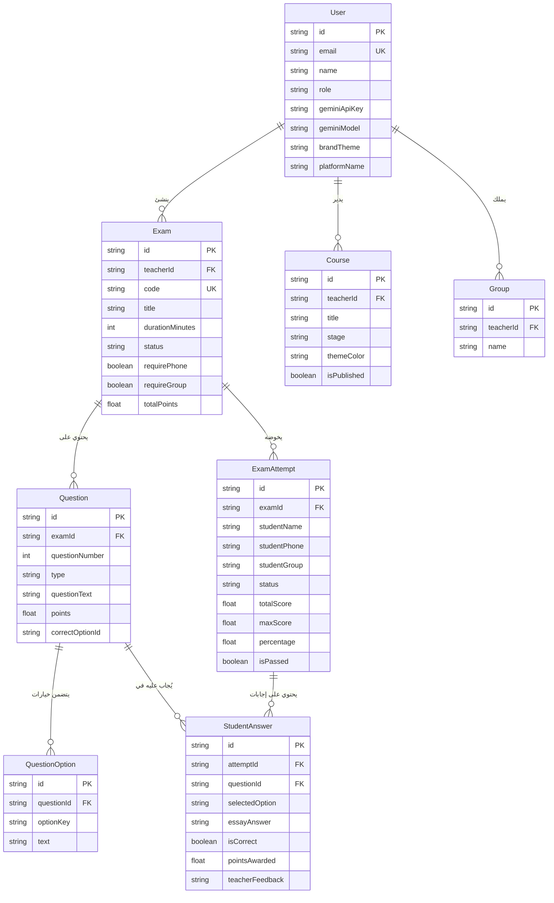

# 📘 التوثيق الشامل والدليل الهندسي لمنصة د.سعيد حسن التعليمية
### (AI PDF Exam & Learning Platform - Architecture & Development Guide)

---

## 📑 فهرس المحتويات
1. [نظرة عامة على المشروع وأهدافه](#1-نظرة-عامة-على-المشروع-وأهدافه)
2. [المكدس التقني (Tech Stack)](#2-المكدس-التقني-tech-stack)
3. [الهيكل المعماري الشامل للمشروع وملفاته (File-by-File Breakdown)](#3-الهيكل-المعماري-الشامل-للمشروع-وملفاته)
   - [ملفات الإعداد والبيئة الجذرية](#ملفات-الإعداد-والبيئة-الجذرية)
   - [طبقة البيانات وقاعدة البيانات (Prisma)](#طبقة-البيانات-وقاعدة-البيانات-prisma)
   - [مكتبات الخدمات الأساسية (lib)](#مكتبات-الخدمات-الأساسية-lib)
   - [طبقة منطق الأعمال والخدمات (services)](#طبقة-منطق-الأعمال-والخدمات-services)
   - [واجهات برمجة التطبيقات (API Routes)](#واجهات-برمجة-التطبيقات-api-routes)
   - [واجهات المستخدم والصفحات (App Router Pages)](#واجهات-المستخدم-والصفحات-app-router-pages)
   - [المكونات المشتركة (Components)](#المكونات-المشتركة-components)
4. [مخطط قاعدة البيانات والعلاقات (Database Schema & Relations)](#4-مخطط-قاعدة-البيانات-والعلاقات)
5. [سير عمل النظام ودورة حياة البيانات (System Workflows)](#5-سير-عمل-النظام-ودورة-حياة-البيانات)
   - [سير عمل استخراج الأسئلة من PDF بالذكاء الاصطناعي](#سير-عمل-استخراج-الأسئلة-من-pdf-بالذكاء-الاصطناعي)
   - [سير عمل إعداد ونشر الامتحان](#سير-عمل-إعداد-ونشر-الامتحان)
   - [سير عمل الطالب في أداء الاختبار والحفظ المؤقت](#سير-عمل-الطالب-في-أداء-الاختبار-والحفظ-المؤقت)
   - [محرك التصحيح التلقائي وتصحيح المقالي](#محرك-التصحيح-التلقائي-وتصحيح-المقالي)
   - [محرك التحليلات والإحصائيات](#محرك-التحليلات-والإحصائيات)
6. [الأمان، الصلاحيات، وحماية البيانات (Security Architecture)](#6-الأمان-الصلاحيات-وحماية-البيانات)
7. [دليل التعديل والتطوير المستقبلي خطوة بخطوة (Future Roadmap & Extension Guide)](#7-دليل-التعديل-والتطوير-المستقبلي-خطوة-بخطوة)

---

## 1. نظرة عامة على المشروع وأهدافه

المشروع عبارة عن منصة تعليمية واختبارات تفاعلية متقدمة ومخصصة لمادة **اللغة العربية** لمعلم خبير (الدكتور سعيد حسن). تم تصميم المنصة لتوفر أداءً عالي السرعة، معالجة فورية للمستندات بالذكاء الاصطناعي، ونظام اختبارات مقاوم للغش ومريح للطالب والمعلم على حدٍ سواء:

- **للمعلم:** رفع ملف PDF لأي امتحان ورقي، حيث يقوم نموذج **Google Gemini** الذكي بتحليله حرفياً، استخراج التشكيل بدقة، فصل أسئلة الاختيار من متعدد (MCQ) عن الأسئلة المقالية (Essay)، وتجهيز مسودة متكاملة يمكن مراجعتها وتعديلها ونشرها بلينك مباشر أو QR Code. كما توفر لوحة التحكم نظام تصحيح سريع للمقالي، إدارة المجموعات، إدارة الكورسات، وتحليلات أداء الطلاب والأسئلة الأكثر صعوبة.
- **للطالب:** واجهة خفيفة وسريعة بدون حاجة لإنشاء حساب معقد، حفظ فوري محلي للإجابات (LocalStorage Auto-save) لمنع فقدان البيانات عند انقطاع الاتصال، عداد وقت تنازلي مع تسليم تلقائي، وبيئة خالية من تسريب الإجابات النموذجية.
- **للزائر:** صفحة رئيسية فخمة تبرز سيرة المعلم وإنجازاته، كورساته ومذكراته، اختبارات تفاعلية متاحة، ونظام ثيمات مزدوج (أرجواني ملكي / ذهبي فاخر، مع دعم الوضع الليلي Dark Mode).

---

## 2. المكدس التقني (Tech Stack)

| المجال | التقنية المستخدمة | الدور في المنصة |
|---|---|---|
| **إطار العمل الأساسي** | Next.js 14.2 (App Router) | تقديم الصفحات، SSR/CSR، والـ API Routes |
| **لغة البرمجة** | TypeScript | أمان الأنواع وكتابة كود قياسي خالي من الأخطاء |
| **قاعدة البيانات وORM** | Prisma ORM 5.22 + SQLite (مع دعم Supabase) | نمذجة واستعلامات قاعدة البيانات |
| **الذكاء الاصطناعي** | `@google/generative-ai` (Gemini Flash) | استخراج وفهم نصوص الـ PDF وتنسيقات التشكيل |
| **التصميم والواجهة** | Tailwind CSS 3.4 + CSS Modules | واجهات عصرية متجاوبة مع أنماط Glassmorphism |
| **الأيقونات والتأثيرات** | Lucide React + Canvas Confetti + Recharts | رسومات بيانية وأيقونات واحتفالات النجاح |
| **التوثيق والحماية** | JWT (`jsonwebtoken`) + `bcryptjs` + AES-256-GCM | حماية جلسات المعلم وتشفير مفاتيح API الحساسة |
| **التحقق من البيانات** | Zod 3.23 | فحص وتدقيق مدخلات الـ API والـ JSON القادم من الذكاء الاصطناعي |

---

## 3. الهيكل المعماري الشامل للمشروع وملفاته

### ملفات الإعداد والبيئة الجذرية

1. **`package.json`**:
   - يحتوي على كافة التبعيات (Dependencies) وأوامر التشغيل:
     - `npm run dev`: تشغيل خادم التطوير.
     - `npm run build`: توليد Prisma Client ثم عمل Build لمشروع Next.js.
     - `npm run db:push`: تطبيق تعديلات المخطط على قاعدة البيانات دون migrations معقدة.
     - `npm run db:seed`: ملء قاعدة البيانات بالبيانات الافتراضية وحساب المعلم.
     - `npm run db:studio`: فتح واجهة Prisma Studio لتصفح وتعديل البيانات يدوياً.

2. **`next.config.mjs`**:
   - إعدادات Next.js؛ يتضمن `serverComponentsExternalPackages: ['bcryptjs']` لمنع مشاكل التحزيم مع دوال التجزئة الثنائية.

3. **`tailwind.config.ts`**:
   - تعريف ألوان المظهر: تدرجات `navy` المظلمة، تدرجات `violet` الملكية، واللون الأساسي `brand`، مع مفاتيح الـ Animations الخاصة بـ float و glow، وتعيين خطوط `Cairo` و `Tajawal`.

4. **`tsconfig.json`**:
   - إعدادات مترجم TypeScript ومسار الاختصار `@/*` الذي يشير إلى المجلد الرئيسي للمشروع.

5. **`middleware.ts`**:
   - وسيط الحماية الأساسي؛ يعترض أي طلب يبدأ بـ `/teacher/*`. إذا لم يكن الكوكي `auth_token` موجوداً، يُعاد توجيه المستخدم تلقائياً إلى صفحة `/login` مع حفظ مسار الرغبة `?redirect=...`.

6. **`.env` & `.env.example`**:
   - متغيرات البيئة السرية:
     - `DATABASE_URL`: مسار ملف قاعدة بيانات SQLite (`file:./dev.db`).
     - `JWT_SECRET`: مفتاح توقيع جلسات المعلمين.
     - `ENCRYPTION_SECRET`: مفتاح سري 32-بايت لتشفير مفاتيح Gemini API في قاعدة البيانات عبر AES-256-GCM.
     - `GOOGLE_GEMINI_API_KEY`: مفتاح Gemini الاحتياطي للمنصة.
     - `DEFAULT_GEMINI_MODEL`: النموذج الافتراضي (`gemini-2.5-flash`).
     - إعدادات Supabase السحابية في حال الرغبة بالتبديل إليها.

---

### طبقة البيانات وقاعدة البيانات (Prisma)

1. **`prisma/schema.prisma`**:
   - المرجع الشامل لجميع نماذج البيانات (Models):
     - `User`: حسابات المعلمين والإدارة، يحتوي على بيانات الملف الشخصي، النصوص الترحيبية، الثيم، ومفتاح Gemini المشفر.
     - `Course`: الكورسات التعليمية المعروضة في الصفحة الرئيسية ولوحة التحكم.
     - `Group`: المجموعات الدراسية (السناتر، الأونلاين، المجموعات الخاصة).
     - `Exam`: بيانات الامتحان (العنوان، الكود المميز، التوقيت، متطلبات الهاتف والمجموعة، درجات النجاح).
     - `Question`: الأسئلة التابعة للامتحان (MCQ أو مقالي، الدرجة، الإجابة الصحيحة، ترتيب السؤال).
     - `QuestionOption`: خيارات السؤال الاختياري (`a`, `b`, `c`, `d`).
     - `ExamAttempt`: جلسات حل الطلاب (الاسم، الهاتف، المجموعة، الدرجات، النسبة، حالة النجاح، التوقيت).
     - `StudentAnswer`: تفاصيل إجابات الطالب لكل سؤال على حدة مع تقييم المعلم وملاحظاته.

2. **`prisma/seed.js`**:
   - سكربت التهيئة الأولية: ينشئ حساب المعلم التجريبي (`teacher@example.com` / `password123`)، المجموعات الافتراضية، 3 دورات تعليمية نموذجية، وامتحان كامل تفاعلي تجريبي بكود `ARB-101`.

---

### مكتبات الخدمات الأساسية (lib)

1. **`lib/db.ts`**:
   - تهيئة وإدارة مثيل موحد لـ `PrismaClient` وفق نمط Singleton لمنع تعدد الاتصالات أثناء التطوير (Hot Reloading).

2. **`lib/auth.ts`**:
   - منطق التوثيق والجلسات:
     - `hashPassword()` و `verifyPassword()` للتشفير ومقارنة كلمات المرور.
     - `signToken()` لتوليد JWT صالح لمدة 7 أيام.
     - `verifyToken()` للتحقق من صلاحية التوكن وفك حمولته.
     - `requireTeacherAuth()` دالة تحقق مركزية تُستدعى في بداية كل API محمي للمعلم، تفحص التوكن في الكوكيز أو ترويسة `Authorization: Bearer`.
     - `setAuthCookie()` و `clearAuthCookie()` لتعيين ومسح كوكيز الجلسة (`auth_token`) مع خصائص `httpOnly` و `sameSite: 'lax'`.

3. **`lib/crypto.ts`**:
   - نظام التشفير المتماثل للبيانات الحساسة:
     - يستخدم خوارزمية **AES-256-GCM** مع IV عشوائي و Authentication Tag.
     - `encryptSecret()`: لتشفير مفتاح Gemini الخاص بالمعلم قبل تخزينه في قاعدة البيانات.
     - `decryptSecret()`: لفك التشفير عند الحاجة لاستدعاء الذكاء الاصطناعي.
     - `maskApiKey()`: لإخفاء المفتاح وعرض بدايته ونهايته فقط في واجهة الإعدادات حفاظاً على الخصوصية.

4. **`lib/rate-limit.ts`**:
   - محدد معدل الطلبات في الذاكرة (In-Memory Sliding Window):
     - يمنع هجمات التخمين على تسجيل الدخول (10 محاولات لكل 5 دقائق لكل IP).
     - يحمي خادم الـ PDF من الضغط (10 عمليات رفع لكل دقيقة لكل معلم).
     - يحتوي على منظف دوري ينظف الذاكرة كل 5 دقائق تلقائياً.

5. **`lib/supabase.ts`**:
   - عملاء الاتصال بـ Supabase (عميل عادي متاح للواجهة وعميل إداري كامل الصلاحيات).

6. **`lib/utils.ts`**:
   - دوال مساعدة عامة:
     - `cn()`: لدمج كلاسات Tailwind مع clsx.
     - `formatArabicNumber()` و `formatTime()`: لتنسيق الثواني لصيغة `MM:SS`.
     - `generateExamCode()`: لتوليد أكواد امتحانات فريدة مثل `ARB-4821` خالية من الحروف الملتبسة.
     - `sanitizeRichText()`: تطهير نصوص الأسئلة العربية، تحويل علامات التسطير `__كلمة__` إلى `<u>كلمة</u>` والتغميق `**كلمة**` إلى `<strong>كلمة</strong>`، مع حذف وسوم `<script>` و `<iframe>` لمنع هجمات XSS مع الحفاظ الكامل على علامات التشكيل.

---

### طبقة منطق الأعمال والخدمات (services)

1. **`services/ai/gemini-parser.ts`**:
   - جوهر الذكاء الاصطناعي لاستخراج الامتحانات من PDF:
     - يعتمد على مكتبة `@google/generative-ai`.
     - يرسل ملف الـ PDF كبيانات `inlineData` (base64) دون الحاجة لرفعه على خوادم خارجية وسيطة.
     - برومبت صارم ومتخصص جداً في قواعد اللغة العربية والنحو والبلاغة، يُلزم النموذج بـ:
       1. استخراج حرفي تام (Verbatim) بدون أي اختصار أو تأليف.
       2. الحفاظ الكامل والدقيق على التشكيل (الفتحة، الضمة، الكسرة، السكون، الشدة، التنوين).
       3. الحفاظ على التنسيقات المتقدمة والخطوط السفلية تحت الكلمات المطلوب إعرابها باستخدام وسوم `<u>`.
       4. تصنيف الأسئلة إلى MCQ أو Essay مع خيارات `a, b, c, d`.
     - يحتوي على آلية استرجاع تلقائي مرنة (Graceful Fallback & Retry): يجرب أولاً النموذج المختار، ثم يرجع تلقائياً لنماذج مثل `gemini-2.5-flash` أو `gemini-3.6-flash` أو `gemini-3.5-flash-lite` مع معالجة ذكية لأخطاء الضغط (503 / 429).
     - فحص دقيق عبر Zod Schema لضمان سلامة بنية الـ JSON المُستخرج.

2. **`services/grading/grading-service.ts`**:
   - محرك التصحيح وحساب الدرجات:
     - `gradeAttemptOnSubmission()`: يعمل تلقائياً لحظة تسليم الطالب:
       - يصحح أسئلة MCQ فوراً مقارنة بالإجابة المسجلة في قاعدة البيانات ويمنح الدرجات.
       - ينشئ سجلات الأسئلة المقالية بحالة "معلقة" (`isCorrect: null`).
       - إذا كان الامتحان يحتوي على أسئلة مقالية تصبح حالته `SUBMITTED`، وإذا كان كله MCQ تصبح حالته `GRADED`.
       - يحسب النسبة المئوية ويحدد حالة الاجتياز `isPassed`.
     - `gradeEssayAnswer()`: عند قيام المعلم بتصحيح سؤال مقالي معين وإعطاء درجة وملاحظات:
       - يُحدث سجل الإجابة الفردية.
       - يُعيد تجميع درجات الطالب في المحاولة فوراً وتحديث النسبة وحالة الامتحان الإجمالية.

3. **`services/exam/stats-service.ts`**:
   - محرك التحليلات والإحصائيات:
     - يحسب عدد الاختبارات والمحاولات والطلاب الفريدين ومتوسط الدرجات ونسبة النجاح ومتوسط الوقت المستغرق.
     - يوزع درجات الطلاب على 4 فئات بيانية: (<50%، 50%-69%، 70%-84%، 85%-100%).
     - يستخرج **أصعب 5 أسئلة** في امتحانات المعلم (الأسئلة التي حصلت على أعلى نسبة إجابات خاطئة بين الطلاب) لتنبيه المعلم لنقاط الضعف الجماعية.

---

### واجهات برمجة التطبيقات (API Routes)

#### 1. مسارات المصادقة (`/api/auth/`)
- `POST /api/auth/login`: فحص البريد وكلمة المرور، تطبيق الـ Rate Limit، وتعيين كوكي الـ JWT الآمن.
- `POST /api/auth/logout`: إبطال وحذف كوكي الجلسة.
- `GET /api/auth/me`: جلب بيانات المعلم الحالي للتحقق من صلاحية الجلسة في الواجهة.

#### 2. المسارات العامة للطلاب والزوار (`/api/public/`)
- `GET /api/public/settings`: إرجاع بيانات ملف المعلم (الاسم، اللقب، النبذة، الإحصائيات، الثيم، روابط الصور) بدون كشف أي بيانات سرية، مع إبطال الكاش لضمان التحديث الفوري.
- `GET /api/public/courses`: جلب قائمة الكورسات المنشورة لعرضها بالصفحة الرئيسية.
- `GET /api/public/exams`: جلب قائمة الاختبارات المنشورة والمتاحة حالياً للطلاب.
- `GET /api/public/exams/[code]`: جلب بيانات اختبار محدد بكوده الخاص (مثل `ARB-101`)؛ يتم تطهير الأسئلة وحجب الإجابات الصحيحة تماماً (`correctOptionId`) لحماية الامتحان من الاختراق والتفتيش في أدوات المتصفح (Inspect Element).

#### 3. مسارات جلسة الطالب (`/api/student/`)
- `POST /api/student/attempt`: بدء جلسة اختبار جديدة للطالب بعد التحقق من الاسم ورقم الهاتف والمجموعة، ومنع تكرار المحاولات إذا كان المعلم قد ألغى المحاولات المتعددة.
- `POST /api/student/autosave`: حفظ تقدم الطالب والوقت وإجاباته مؤقتاً في السيرفر دون إيقاف امتحانه.
- `POST /api/student/submit`: تسليم الامتحان النهائي، استدعاء محرك التصحيح، وتسجيل وقت الحل.

#### 4. مسارات لوحة المعلم (`/api/teacher/`)
- `POST /api/teacher/upload-pdf`: استلام ملف الـ PDF، فحص بصمة الملف السحرية (`%PDF-`) وحجمه، واستخراج الأسئلة عبر Gemini.
- `GET /api/teacher/exams`: جلب جميع امتحانات المعلم مع عدد الأسئلة والمحاولات ومتوسط الدرجات.
- `POST /api/teacher/exams`: إنشاء امتحان جديد (مسودة أو منشور).
- `GET / PUT / DELETE /api/teacher/exams/[id]`: جلب تفاصيل امتحان للمراجعة، تحديث الأسئلة والإعدادات بالكامل، أو حذف الامتحان.
- `POST /api/teacher/exams/[id]/publish`: تغيير حالة الامتحان بضغطة زر بين (مسودة DRAFT، منشور PUBLISHED، مغلق CLOSED).
- `GET /api/teacher/results`: جلب جميع نتائج ومحاولات الطلاب مع إمكانية الفلترة باسم الطالب، هاتفه، امتحانه، مجموعته، أو حالة التصحيح.
- `GET / POST /api/teacher/results/[attemptId]`: عرض محاولة طالب بالتفصيل لمشاهدة إجاباته وسؤال بسؤال، وتصحيح الأسئلة المقالية وإضافة تعليقات توجيهية له.
- `GET / POST /api/teacher/analytics`: إحصائيات لوحة التحكم الشاملة وتوزيع الدرجات وأصعب الأسئلة.
- `GET / POST /api/teacher/courses` & `.../courses/[id]`: إدارة الكورسات والمناهج (إضافة، تعديل، حذف، ترتيب).
- `GET / POST / DELETE /api/teacher/groups`: إدارة المجموعات الدراسية المتاحة لطلاب المعلم.
- `GET / POST /api/teacher/settings`: عرض وتعديل بيانات المعلم، فحص مفتاح Gemini API وتغيير النموذج، وتعيين الثيم العام (بنفسجي أو ذهبي).

---

### واجهات المستخدم والصفحات (App Router Pages)

1. **`app/page.tsx` (الصفحة الرئيسية العامة):**
   - واجهة عصرية تحتوي على النافبار العلوي مع زر تبديل الثيم وزر تسجيل دخول المعلم.
   - قسم البطل (Hero Section) يعرض صورة الدكتور سعيد حسن، النبذة الشخصية، وأرقام الخبرة والطلاب.
   - مربع البحث السريع عن أي امتحان بواسطة الكود والانتقال إليه فوراً.
   - قائمة الاختبارات المنشورة مع تفاصيل كل امتحان (المدة، عدد الأسئلة، الدرجة).
   - قسم الكورسات والمناهج التعليمية المتاحة.
   - مميزات المنصة الذكية وقسم التواصل.

2. **`app/login/page.tsx` (صفحة تسجيل دخول المعلم):**
   - تصميم أنيق بخلفية مظلمة وتأثيرات ضوئية.
   - حقول البريد الإلكتروني وكلمة المرور مع إشعار خطأ تفاعلي وربط فوري بالتوكن.

3. **`app/exam/[code]/page.tsx` (صفحة الامتحان للطلاب):**
   - **بوابة الدخول:** يطلب اسم الطالب، رقم الهاتف، واختيار مجموعته من القائمة، مع مربع الموافقة.
   - **شاشة الامتحان التفاعلية:**
     - عداد زمني في الأعلى يتغير لونه عند اقتراب النهاية.
     - حفظ تلقائي فوري في LocalStorage لكل اختيار يضغط عليه الطالب لمنع ضياع الإجابات حتى لو انقطع الإنترنت.
     - مراقبة حالة الاتصال بالإنترنت (Online/Offline indicator).
     - دعم التشكيل الكامل والخطوط السفلية للأسئلة النحوية.
     - تنقل سلس بين الأسئلة وترقيم واضح.
   - **شاشة النتيجة:** عند التسليم يظهر احتفال Confetti، وتظهر رسالة نجاح أو تفاصيل النتيجة وفق إعدادات المعلم.

4. **`app/teacher/layout.tsx`:**
   - الإطار العام للوحة التحكم؛ يتحقق من جلسة المعلم في السيرفر ويعرض النافبار والسايدبار ومحتوى الصفحة.

5. **`app/teacher/dashboard/page.tsx`:**
   - لوحة القيادة السريعة: بطاقات إحصائيات رئيسية، زر لرفع امتحان سريع، أحدث الاختبارات، وآخر نتائج الطلاب المسلمة مع تحديث تلقائي كل 20 ثانية.

6. **`app/teacher/exams/new/page.tsx`:**
   - واجهة السحب والإفلات لملفات الـ PDF.
   - شريط تقدم ومراحل تحليلية متحركة توضح للمعلم ما يفعله الذكاء الاصطناعي خطوة بخطوة.
   - توجيه فوري لصفحة المراجعة فور اكتمال الاستخراج.

7. **`app/teacher/exams/[id]/review/page.tsx`:**
   - استعراض كامل للأسئلة المستخرجة مع إمكانية تعديل نصوص الأسئلة، النقاط، الإجابة الصحيحة للـ MCQ، وإضافة أو حذف خيارات أو أسئلة.
   - إعدادات الامتحان: تحديد الوقت، اشتراط الهاتف والمجموعة، وتحديد المجموعات المسموح لها.
   - زر النشر المباشر مع نافذة منبثقة لنسخ الرابط ورمز QR Code لمشاركته على مجموعات واتساب أو تيليجرام.

8. **`app/teacher/exams/page.tsx`:**
   - جدول كافة الاختبارات السابقة مع فلترة بالبحث، ومؤشرات حالة الاختبار (مسودة / منشور / مغلق)، وإجراءات سريعة لتعديل أو حذف أو نسخ رابط الاختبار.

9. **`app/teacher/results/page.tsx` & `[attemptId]/page.tsx`:**
   - جدول شامل لنتائج الطلاب، مع تمييز المحاولات التي تحتاج إلى تصحيح أسئلة مقالية ببادج واضح.
   - صفحة فحص إجابات الطالب بالكامل، منح درجات للأسئلة المقالية، كتابة تعليقات توجيهية، وطباعة نموذج الإجابة أو حفظ النتيجة.

10. **`app/teacher/analytics/page.tsx`:**
    - رسوم بيانية تفاعلية باستخدام مكتبة `recharts` لتوزيع الدرجات، بالإضافة لجدول الأسئلة الأكثر صعوبة.

11. **`app/teacher/courses/page.tsx` & `app/teacher/groups/page.tsx`:**
    - إدارة كاملة للمحتوى الإضافي والمجموعات مع نوافذ منبثقة سريعة (Modals) للإضافة والتعديل.

12. **`app/teacher/settings/page.tsx`:**
    - إعدادات متكاملة في 3 تبويبات:
      1. الملف الشخصي ونصوص الصفحة الرئيسية.
      2. ألوان وهوية الموقع (أرجواني ملكي / ذهبي).
      3. إعدادات Google Gemini: فحص صلاحية المفتاح، اختيار النموذج، وتحديث المفتاح المشفر.

---

### المكونات المشتركة (Components)

- **`components/teacher/Navbar.tsx`**: الشريط العلوي للوحة التحكم، يضم زر رفع امتحان جديد، اسم المعلم، وزر تسجيل الخروج.
- **`components/teacher/Sidebar.tsx`**: القائمة الجانبية للتنقل بين أقسام لوحة المعلم مع شارة حالة الذكاء الاصطناعي.
- **`components/theme/ThemeProvider.tsx`**: سياق موحد لإدارة الوضعين: الليلي/النهاري، والسمة اللونية (Violet / Gold)، مع حفظ التفضيلات في `localStorage`.
- **`components/ui/Modal.tsx`**: نافذة منبثقة متجاوبة وقابلة للإغلاق بزر Esc أو النقر بالخارج.
- **`components/ui/Toast.tsx`**: نظام إشعارات عائم (نجاح، خطأ، تنبيه) بدون مكتبات خارجية ثقيلة.

---

## 4. مخطط قاعدة البيانات والعلاقات



---

## 5. سير عمل النظام ودورة حياة البيانات

### سير عمل استخراج الأسئلة من PDF بالذكاء الاصطناعي
1. يقوم المعلم بسحب وإفلات ملف PDF في `/teacher/exams/new`.
2. يتم إرسال الملف إلى `POST /api/teacher/upload-pdf`.
3. يتحقق السيرفر من: معدل الرفع (Rate Limit)، امتداد الملف، حجمه (< 25MB)، وبصمته السحرية (`%PDF-`).
4. يسترجع السيرفر مفتاح Gemini الخاص بالمعلم من قاعدة البيانات ويفك تشفيره بـ AES-256-GCM (أو يستخدم مفتاح البيئة الاحتياطي).
5. يتم استدعاء `GeminiExamParser`:
   - تحويل ملف الـ PDF إلى Base64.
   - إرساله لنموذج Gemini المختار مع برومبت التشكيل والتنسيق الحرفي المتقدم.
   - في حالة حدوث ضغط على خوادم الذكاء الاصطناعي (503 / 429)، يقوم النظام بمحاولة ثانية تلقائية، ثم التبديل التلقائي للنموذج البديل (`gemini-2.5-flash` أو `gemini-3.6-flash`).
6. يتحقق كود الخادم من صحة بنية الـ JSON الناتجة عبر `Zod ExamSchema`.
7. تُحفظ النتيجة مباشرة كـ مسودة امتحان (`status: DRAFT`) في قاعدة البيانات مع كود عشوائي فريد، ويتم توجيه المعلم فوراً لصفحة المراجعة `/teacher/exams/[id]/review`.

### سير عمل إعداد ونشر الامتحان
1. في صفحة المراجعة، يراجع المعلم الأسئلة المستخرجة، ويستطيع تعديل نص أي سؤال، خياراته، وإجابته النموذجية.
2. يحدد خيارات الامتحان: الوقت المتاح بالدقائق، هل يلزم رقم هاتف؟ هل يلزم اختيار مجموعة؟
3. يضغط المعلم على زر **نشر الاختبار الآن**:
   - يُرسل طلب إلى `POST /api/teacher/exams/[id]/publish` بحالة `PUBLISHED`.
   - يفتح النظام نافذة تتضمن رابط الامتحان المباشر (`/exam/CODE`) ورمز الاستجابة السريعة (QR Code).

### سير عمل الطالب في أداء الاختبار والحفظ المؤقت
1. يفتح الطالب الرابط `/exam/[code]` أو يمسح الـ QR.
2. تطلب الواجهة بياناته: الاسم، رقم الهاتف، والمجموعة الدراسية.
3. عند الضغط على "بدء الاختبار"، يُرسل طلب إلى `POST /api/student/attempt`، فيتم إنشاء محاولة جديدة في قاعدة البيانات بحالة `IN_PROGRESS`.
4. عند اختيار أي إجابة، يتم حفظها **فوراً وبشكل لحظي في الذاكرة المحلية للمتصفح (LocalStorage)** بدون استهلاك شبكة الإنترنت، مما يمنح الطالب سرعة فائقة ويحميه من ضياع الإجابات في حال انقطاع الكهرباء أو شبكة الهاتف.
5. يعمل عداد الوقت التنازلي في الواجهة، وإذا انتهى الوقت المحدد يتم تسليم الامتحان تلقائياً.

### محرك التصحيح التلقائي وتصحيح المقالي
1. يضغط الطالب على "تسليم الاختبار" -> يتم استدعاء `POST /api/student/submit`.
2. يستدعي السيرفر `GradingService.gradeAttemptOnSubmission`:
   - أسئلة الـ MCQ: تُقارن إجابة الطالب بـ `correctOptionId` المسجل بالسيرفر؛ إذا تطابقت يُمنح الدرجة كاملة وتُسجل `isCorrect: true`، وإلا فـ 0 وتُسجل `false`.
   - أسئلة المقالي: تُسجل إجابة الطالب وتُترك بحالة معلقة (`isCorrect: null`).
   - إذا كان الامتحان يحتوي على أي أسئلة مقالية، تصبح حالة المحاولة `SUBMITTED` (بانتظار تصحيح المعلم).
   - إذا كان الامتحان بالكامل MCQ، تصبح حالة المحاولة `GRADED` (مصحح نهائياً).
3. يدخل المعلم على صفحة `/teacher/results/[attemptId]`:
   - يشاهد إجابات الطالب المقالية ويضع الدرجة المستحقة ويكتب ملاحظاته.
   - بمجرد الحفظ، يُستدعى `GradingService.gradeEssayAnswer` لإعادة حساب المجموع الكلي والنسبة وتحديد ما إذا كان الطالب ناجحاً أم راسباً، وتحديث حالة الامتحان إلى `GRADED`.

---

## 6. الأمان، الصلاحيات، وحماية البيانات

1. **حماية مسارات المعلم بلوحة التحكم:**
   - ملف `middleware.ts` يعترض مسارات `/teacher/*`.
   - دوال الـ API تتحقق بواسطة `requireTeacherAuth()` التي تقرأ الـ JWT المشفّر من كوكي `httpOnly` محمي من هجمات XSS في المتصفح.

2. **حظر تسريب الإجابات النموذجية (Anti-Cheat & Zero-Leakage):**
   - نقطة النهاية المفتوحة للطلاب `GET /api/public/exams/[code]` تقوم بحذف وتطهير حقل `correctOptionId` تماماً قبل إرسال الأسئلة، مما يجعل من المستحيل على أي طالب استخراج الإجابات الصحيحة من خلال فحص شبكة المتصفح (Inspect Element).

3. **تشفير مفاتيح Gemini API:**
   - مفتاح API الخاص بالمعلم لا يُخزن كنص صريح أبداً؛ بل يتم تشفيره عبر خوارزمية **AES-256-GCM** مع مفتاح سري وتخزينه بصيغة `iv:authTag:encryptedHex`.

4. **الحد من الهجمات ومعدل الطلبات (Rate Limiting):**
   - حماية تسجيل الدخول من محاولات التخمين (Brute-Force).
   - حماية رفع ملفات الـ PDF لمنع الإغراق واستهلاك رصيد الـ API.

5. **تطهير المدخلات اللغوية (Rich Text Sanitization):**
   - دالة `sanitizeRichText` في `lib/utils.ts` تحذف وسوم الجافاسكريبت والأطر غير الموثوقة مع الحفاظ التام على تشكيل الحروف العربية والخطوط السفلية النحوية.

---

## 7. دليل التعديل والتطوير المستقبلي خطوة بخطوة

إذا أردت إجراء أي تعديل مستقبلي، إليك المسارات والملفات المباشرة لكل تعديل:

### 1. تعديل البرومبت أو طريقة استخراج الأسئلة بالذكاء الاصطناعي
- **الملف المعني:** `services/ai/gemini-parser.ts`
- **ماذا تعدل:** المتغير `systemPrompt` (الأسطر 104-173). يمكنك إضافة تعليمات جديدة، مثل التعرف على صور أو رسومات داخل الـ PDF، أو إضافة أنواع أسئلة جديدة مثل أسئلة "صح أو خطأ".

### 2. تعديل نموذج قاعدة البيانات (إضافة حقول جديدة)
- **الملف المعني:** `prisma/schema.prisma`
- **الخطوات:**
  1. أضف الحقل الجديد في النموذج المناسب (مثلاً إضافة `studentEmail` في `ExamAttempt` أو إضافة `category` في `Course`).
  2. افتح موجه الأوامر وشغل:
     ```bash
     npm run db:push
     ```
  3. سيتم تحديث جدول قاعدة البيانات وتوليد الـ TypeScript Types تلقائياً دون فقدان البيانات.

### 3. تعديل واجهة الامتحان للطلاب (تغيير السلوك، العداد، أو الألوان)
- **الملف المعني:** `app/exam/[code]/page.tsx`
- **ماذا تعدل:**
  - لتغيير سلوك العداد أو طريقة العرض: راجع `useEffect` الخاص بـ Timer (السطر 192).
  - لتغيير شاشة إدخال بيانات الطالب: راجع كود Form (السطر 320 وما بعده).
  - لتغيير تصميم الأسئلة وخيارات الـ MCQ: راجع مكون الأسئلة وتحديد الخيارات `handleSelectOption`.

### 4. تعديل نصوص أو أقسام الصفحة الرئيسية (Landing Page)
- **الملف المعني:** `app/page.tsx`
- **ماذا تعدل:** يحتوي الملف على مكونات أقسام: `HeroSection`، `ExamsSection`، `CoursesSection`، و `Footer`. النصوص الافتراضية تُجلب من `/api/public/settings` أو من State الصفحة.

### 5. إضافة بوابات دفع إلكتروني (فودافون كاش / فوري / Paymob)
- **الخطوات المقترحة:**
  1. إنشاء مسار API جديد مثل `app/api/student/payment/route.ts`.
  2. إضافة حقل `isPaid` و `price` في جدول `Exam` أو `Course` بملف `prisma/schema.prisma`.
  3. تعديل بوابة بدء الامتحان في `app/exam/[code]/page.tsx` بحيث تتحقق من إتمام الدفع قبل استدعاء `handleStartExam`.

### 6. إضافة ميزة تصدير النتائج إلى Excel
- **الملف المعني:** `app/teacher/results/page.tsx`
- **الخطوات:**
  - يمكنك استخدام مكتبة مثل `xlsx` لتحويل مصفوفة `results` الموجودة في الصفحة مباشرة إلى ملف `xlsx` عند الضغط على زر التصدير (الموجود كـ placeholder بالفعل بالأيقونة `FileSpreadsheet`).

### 7. تبديل قاعدة البيانات من SQLite إلى PostgreSQL / Supabase للإنتاج
- **الملف المعني:** `prisma/schema.prisma`
- **الخطوات:**
  1. تغيير الـ `provider` من `"sqlite"` إلى `"postgresql"`.
  2. تغيير `DATABASE_URL` في ملف `.env` إلى رابط الاتصال بـ PostgreSQL من Supabase أو Neon.
  3. تشغيل `npm run db:push` لإنشاء الجداول على السحابة مباشرة.

---
**تم إعداد هذا التوثيق ليكون مرجعاً تقنياً وتطويرياً شاملاً لمنصة د.سعيد حسن.**
